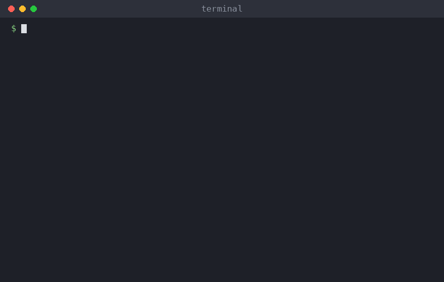

# pptx-to-md

[](https://github.com/kursluzz/pptx-to-md/actions/workflows/ci.yml)
[](LICENSE)


Convert PowerPoint (`.pptx`) presentations to clean Markdown. Optionally, an LLM transcribes the text inside
pictures and writes a short description of every picture and slide, so decks become fully searchable and
usable as input for other LLMs, wikis and knowledge bases.



## What you get

For every slide:

- the title, text boxes, shapes, grouped shapes, bullet lists (with nesting), tables (as Markdown tables) and chart titles / series labels;
- speaker notes;
- every picture, saved next to the Markdown file and linked from it (using the author's alt text when there is one);
- **with `--llm`**: the text found inside each picture, plus a description of each picture and of each slide.

See [`examples/`](examples) for a sample deck and its output.

## Install

You need Python 3.11+. The base install has no LLM dependencies.

```bash
# recommended: an isolated command-line tool (https://docs.astral.sh/uv/)
uv tool install "git+https://github.com/kursluzz/pptx-to-md"

# or with pip
pip install "git+https://github.com/kursluzz/pptx-to-md"

# try it without installing
uvx --from "git+https://github.com/kursluzz/pptx-to-md" pptx-to-md deck.pptx
```

To use an LLM, add the extra for your provider:

```bash
uv tool install "pptx-to-md[bedrock] @ git+https://github.com/kursluzz/pptx-to-md"   # Amazon Bedrock
uv tool install "pptx-to-md[openai] @ git+https://github.com/kursluzz/pptx-to-md"    # OpenAI & compatible APIs
uv tool install "pptx-to-md[all] @ git+https://github.com/kursluzz/pptx-to-md"       # both
```

(with pip: `pip install "pptx-to-md[openai] @ git+https://github.com/kursluzz/pptx-to-md"`)

## Usage

```bash
pptx-to-md deck.pptx                 # -> ./output/deck.md and ./output/deck_assets/
pptx-to-md slides/ -o notes          # every .pptx below slides/, folder layout preserved
pptx-to-md deck.pptx --llm           # also describe pictures and slides with an LLM
```

By default **no LLM is used**: the conversion is local, free and offline. `--llm` is always explicit because it
sends data to a third party and may cost money.

| Option | Meaning |
|---|---|
| `-o, --output DIR` | output directory (default `./output`) |
| `--llm` | describe pictures and slides with an LLM |
| `--provider {bedrock,openai}` | override the configured provider |
| `--model ID` | override the model |
| `--workers N` | parallel LLM requests (default 2) |
| `-v, --verbose` | log progress and per-deck LLM usage |
| `--version` | print the version |

Exit code: `0` all decks converted, `1` at least one failed (or no `.pptx` found), `2` configuration error.
A failing deck never stops the others, and a deck whose LLM calls fail is not written half-finished.

## Using an LLM

Two providers are supported. Run the setup once:

```bash
pptx-to-md configure
```

The first `pptx-to-md deck.pptx --llm` also starts this setup if nothing is configured. It asks for:

- **Amazon Bedrock** (default model: Amazon Nova 2 Lite): your AWS profile or credentials, the region and the model id.
  The simplest way is to use your existing AWS setup (`aws configure`, SSO, environment variables, an IAM role);
  nothing secret is then stored. You can instead store an access key.
  The model must be enabled for your account in the Bedrock console.
- **OpenAI or any OpenAI-compatible API** (OpenRouter, Ollama, LM Studio, vLLM, ...): base URL, an API key and a model
  that accepts images (default `gpt-4o-mini`).

At the end it can test the connection. Settings are saved to a TOML file that only you can read:

| OS | Location |
|---|---|
| Linux / macOS | `~/.config/pptx-to-md/config.toml` (or `$XDG_CONFIG_HOME/pptx-to-md/`) |
| Windows | `%APPDATA%\pptx-to-md\config.toml` |

`pptx-to-md configure --path` prints the location, `pptx-to-md configure --show` prints the settings with secrets masked.
Set `PPTX_TO_MD_CONFIG` to use a different file.

### Without the config file (CI, scripts, containers)

Everything can come from the environment. Precedence: command line > environment > config file > defaults.

| Variable | Meaning |
|---|---|
| `PPTX_TO_MD_PROVIDER` | `bedrock` or `openai` |
| `PPTX_TO_MD_MODEL` | model id (defaults: `us.amazon.nova-2-lite-v1:0` / `gpt-4o-mini`) |
| `PPTX_TO_MD_WORKERS` | parallel LLM requests (default 2) |
| `OPENAI_API_KEY`, `OPENAI_BASE_URL` | OpenAI provider credentials and endpoint |
| `AWS_PROFILE`, `AWS_REGION`, `AWS_ACCESS_KEY_ID`, `AWS_SECRET_ACCESS_KEY`, ... | standard AWS variables, read by boto3 |
| `PPTX_TO_MD_PRICE_INPUT_PER_1M`, `PPTX_TO_MD_PRICE_OUTPUT_PER_1M` | optional USD prices; enables the cost estimate |

```bash
OPENAI_API_KEY=sk-... PPTX_TO_MD_PROVIDER=openai pptx-to-md deck.pptx --llm
```

### Privacy and cost

With `--llm`, the **text of each slide and every picture** is sent to the provider you chose (one request per
picture, one per slide; the deck as a whole is never sent). Do not use it on confidential decks unless your provider
agreement allows it. Local servers such as Ollama keep everything on your machine.

Each run prints token counts (and an estimated cost if you configured prices) and writes `output/llm_usage.json`.
Identical pictures are described only once per deck.

## Output layout

```
output/<sub-folder>/<deck>.md
output/<sub-folder>/<deck>_assets/img_<hash>.<ext>
```

Existing files are overwritten. Pictures in formats LLMs cannot read (EMF, WMF, SVG, TIFF, ...) are converted to PNG
with Pillow or, if installed, [LibreOffice](https://www.libreoffice.org/); otherwise they are stored unchanged and
not described. Very large pictures are downscaled for the LLM request only; the stored file is untouched.

## Limitations

- Content is emitted in the deck's shape order, which matches reading order in most decks but not all.
- Not extracted: SmartArt, embedded objects/videos, text inside shapes drawn as images, hidden-slide markers,
  formatting (bold, colours) and hyperlinks. Charts contribute title, categories and series names, not values.
- Slide-number, date and footer placeholders are skipped.
- Only `.pptx` files are supported, not legacy `.ppt` (save as `.pptx` first).
- LLM output can be wrong; treat transcriptions and descriptions as a convenience, not a source of truth.

## Python API

```python
from pptx_to_md import convert_file

convert_file("deck.pptx", "output")  # no LLM
```

```python
from pptx_to_md import LLMDescriber, convert_file, load_settings

describer = LLMDescriber(load_settings(provider="openai"))
convert_file("deck.pptx", "output", describer=describer)
print(describer.usage.snapshot())
```

## Development

```bash
git clone https://github.com/kursluzz/pptx-to-md && cd pptx-to-md
uv sync --all-extras
uv run pytest                 # no network, no credentials needed
uv run ruff check . && uv run ruff format --check .
```

See [CONTRIBUTING.md](CONTRIBUTING.md). Source layout:

- `extract.py` reads the deck into the model (`model.py`); `render.py` writes Markdown; `converter.py` orchestrates.
- `llm.py` holds the prompts, retry logic and one backend per provider; `usage.py` does token/cost accounting.
- `config.py` / `configure.py` handle settings and the setup wizard; `cli.py` is the command line.
- `scripts/make_demo_gif.py` regenerates `docs/demo.gif` from a real run.

## License

[MIT](LICENSE)
